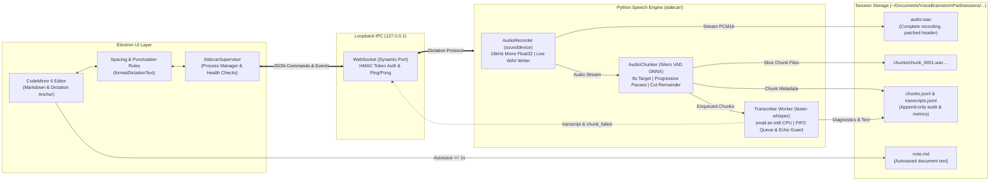

# Voice Brainstorm Pad

> **Local, privacy-first desktop voice brainstorm pad built for fast continuous dictation (300–400 wpm) on consumer CPU laptops without cloud dependencies.**

---

## Overview

**Voice Brainstorm Pad** is an Electron + Python desktop dictation and brainstorming tool designed specifically for fast, unstructured speech ("yapping"). Unlike traditional speech-to-text tools that freeze when speakers talk rapidly without pausing, Voice Brainstorm Pad employs an asynchronous audio pipeline that chunks speech dynamically, runs local speech-to-text using `faster-whisper`, and streams the transcribed text directly into a **CodeMirror 6** markdown editor without hijacking the user's active keyboard cursor.

### Key Pillars
- **100% Offline & Private**: Audio and transcriptions never leave your machine (`local_files_only` enforcement, loopback-only WebSocket).
- **Crash-Resilient Audio**: A live PCM16 WAV writer patches the 44-byte RIFF header every second, ensuring the recording remains playable even if power is cut.
- **Fast-Speech Chunker**: Progressive pause acceptance (300ms $\to$ 150ms $\to$ 80ms) and quietest-frame splitting guarantee words are never chopped in half.
- **Caret-Independent Dictation**: Dictate at an independent visual **dictation anchor** while simultaneously clicking and editing text with your keyboard elsewhere in the document.

---

## System Architecture



---

## Iteration Progress (Iteration 1 to 5)

### **Iteration 1: Foundation & Session Management**
- Electron + TypeScript application shell with single-instance lock.
- Clean session folder storage (`~/Documents/VoiceBrainstormPad/sessions/<timestamp>_<title>/`).
- Document autosave at 500ms debounce with word count metrics.
- Multi-session drawer with session switching, creation, and rename.

### **Iteration 2: Python Sidecar Process & Secure IPC**
- Python sidecar lifetime managed by `SidecarSupervisor`.
- Loopback-only binding (`127.0.0.1`) on an OS-assigned dynamic port (port `0`).
- Origin validation (rejects browser requests to prevent cross-origin WebSocket attacks).
- 64-character per-launch HMAC token handshake within a 3.0s window.
- 10s heartbeat `ping`/`pong` with automatic reconnection.

### **Iteration 3: Audio Capture, Live WAV Writer & Silero VAD**
- 16kHz mono audio streaming using `sounddevice` / PortAudio.
- **Live WAV Writer**: Streams raw PCM16 samples and periodically patches RIFF chunk sizes every second so recordings are immediately playable.
- Dynamic microphone device selection and live RMS level meter.
- **Audio Chunker**: Integrates Silero VAD (ONNX) to distinguish speech vs. silence frames.

### **Iteration 4 & 4.1: faster-whisper ASR & Pipeline Hardening**
- **faster-whisper Engine**: Local `small.en` model running `int8` quantization on 4 CPU threads.
- **Strictly Append-Only Audit Trails**:
  - `chunks.jsonl`: Append-only chunk audio metadata (t_start, t_end, duration).
  - `transcripts.jsonl`: Append-only transcription metrics (seq, text, RTF, latency, model).
- **Session Resume Offsets**: Resuming an existing session calculates starting timestamp from `audio.wav` sample count rather than resetting to `0.0`.
- **Fast-Speech Progressive Pause Detection**:
  - $\ge$ 8.0s: accepts 300ms pause.
  - $\ge$ 10.0s: accepts 150ms pause.
  - $\ge$ 12.0s: accepts 80ms pause.
  - $\ge$ 15.0s (hard limit): cuts at the quietest frame in the last 3.0s, carrying remainder frames forward without word clipping.
- **Asynchronous Queue Drain**: On stop, emits `state: "catching_up"` with pending chunk count without blocking the WebSocket event loop, moving to `idle` only after all chunks are transcribed.
- **Hallucination Suppression & Prompt Continuity**: Bounded temperature fallback tuple `(0.0, 0.2, 0.4)` and 25-word context prompting (`initial_prompt`).
- **Intel MKL OOM Resilience**: Garbage collection retry with greedy decoding (`temperature=0.0`) if MKL heap pressure occurs on Windows.

### **Iteration 5: Streaming Editor Insertion at Dictation Anchor**
- **Dictation Anchor**: Visual pulsating indicator marking where speech arrives in CodeMirror 6.
- **Caret Independence**: Spoken text streams to the anchor; the user can freely click, select, and edit text elsewhere with the keyboard without losing keyboard focus or interrupting transcription.
- **Smart Spacing & Formatting**:
  - Automatic leading spaces before normal words.
  - Zero-space attachment for punctuation (`. , ! ? : ;`).
  - Automatic sentence capitalization following sentence breaks.
  - Automatic paragraph break (`\n\n`) on pauses $\ge$ 2.0s.
- **Anchor Controls**:
  - `Ctrl+Alt+A`: Move dictation anchor to current keyboard caret.
  - `Ctrl+Alt+J`: Jump keyboard caret to dictation anchor.

---

## Frequently Asked Questions

### Q1: If I speak for 30 to 40 minutes straight on CPU (or GPU), will it keep running or crash?
**It will keep running safely.** Here is why:
1. **Real-Time Factor (RTF) is well below 1.0**:
   - In our benchmarks on an Intel CPU, an 8.0-second chunk takes ~3.0s to 5.0s to transcribe ($RTF \approx 0.36\times - 0.65\times$).
   - Because decoding is roughly twice as fast as real-time speech, the transcriber queue does not back up or pile up in RAM.
2. **Fixed-Size Chunking**:
   - Audio is not buffered as one huge 30-minute block in memory. It is sliced into ~8–15 second chunks on disk and queued sequentially.
3. **Bounded Memory & Streamed WAV**:
   - `audio.wav` is appended to disk on the fly, keeping memory usage constant regardless of whether you record for 1 minute or 1 hour.
   - Bounded MKL thread pools (`MKL_NUM_THREADS=4`) and constrained fallback prevent memory fragmentation.
4. **GPU Mode (Optional)**:
   - On an NVIDIA GPU (`device="cuda", compute_type="float16"`), RTF drops to $\sim 0.05\times - 0.10\times$ (near-instantaneous decoding) with negligible CPU load.

---

### Q2: Can words appear instantly as I speak rather than waiting for chunk completion?
Right now, Voice Brainstorm Pad uses **natural phrase chunking** (chunks emit every ~8 seconds or on pauses $\ge$ 300ms). This gives the highest accuracy because Whisper needs acoustic context to resolve ambiguous syllables and homophones.

To achieve **instant real-time typing**, the speech industry uses two complementary approaches:
1. **Speculative Streaming Preview (Roadmap)**:
   - A lightweight streaming acoustic model (such as Silero Streaming or Vosk) runs directly on the audio stream with ~200ms latency, outputting faint/gray "speculative" words as you speak.
   - When the 8-second `faster-whisper` chunk finishes decoding, it replaces the speculative text with the finalized, punctuated, high-accuracy text.
2. **Micro-Chunking (2.0s rolling windows)**:
   - Slicing speech into 2.0s overlapping windows lowers the latency to ~2.5s, at the expense of slightly higher CPU decoding load.

---

## Setup & Running Locally

### Prerequisites
- **Node.js** 18+ and **npm**
- **Python** 3.10+ (with virtual environment in `.venv`)
- Windows, macOS, or Linux

### Installation

1. **Clone the repository**:
   ```bash
   git clone https://github.com/frag2win/Voice-Brainstorm-Pad.git
   cd "Voice-Brainstorm-Pad"
   ```

2. **Install Node dependencies**:
   ```bash
   npm install
   ```

3. **Install Python sidecar dependencies**:
   ```bash
   # In .venv (or virtual environment of choice):
   .\.venv\Scripts\pip install -r sidecar/requirements.txt
   ```

4. **Build the TypeScript application**:
   ```bash
   npm run build
   ```

5. **Start the application**:
   ```bash
   npm start
   ```

---

## Running Tests

### TypeScript / Electron Tests (Vitest)
```bash
npx vitest run
```
*Runs all 49 test cases across session storage, supervisor IPC, anchor movements, and spacing rules.*

### Python Sidecar Tests (Pytest)
```bash
.\.venv\Scripts\python -m pytest tests/test_chunker.py -v
.\.venv\Scripts\python -m pytest tests/test_recorder.py -v
.\.venv\Scripts\python -m pytest tests/test_sidecar.py -v
.\.venv\Scripts\python -m pytest tests/test_transcriber.py -v
```
*Runs all 26 test cases across VAD chunking, WAV header patching, loopback security, and append-only transcript logging.*

---

## License
MIT License. Free for local, personal, and commercial brainstorming.

